**Pruebas de aceptación - Versión tres**

Head Soccer · Desarrollo Orientado a Objetos (DOPO)

Integrantes: Morales S. y Mena S.

Todas las pruebas se hicieron ejecutando presentation.HeadSoccerGUI.

## 1. Jugar contra la máquina

**Pasos:** JUGAR, elegir "Jugador vs Maquina", el perfil Experta y la dificultad Media, y COMENZAR.

**Resultado esperado:** se habilita la lista de perfiles y el jugador 2 queda como "Maquina Experta". En el partido, la máquina se mueve sola y no responde a las flechas. La máquina tarda un poco en reaccionar y no siempre patea, así que se le puede ganar.

**Resultado:** pasa.

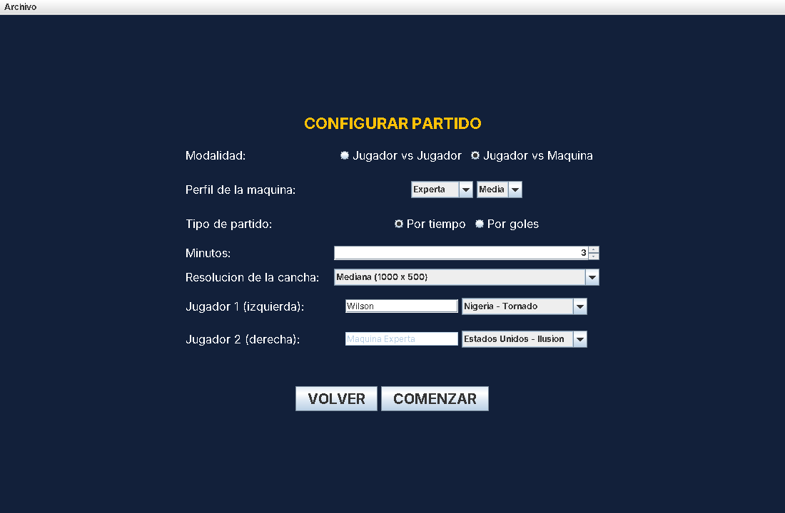{width=70%}

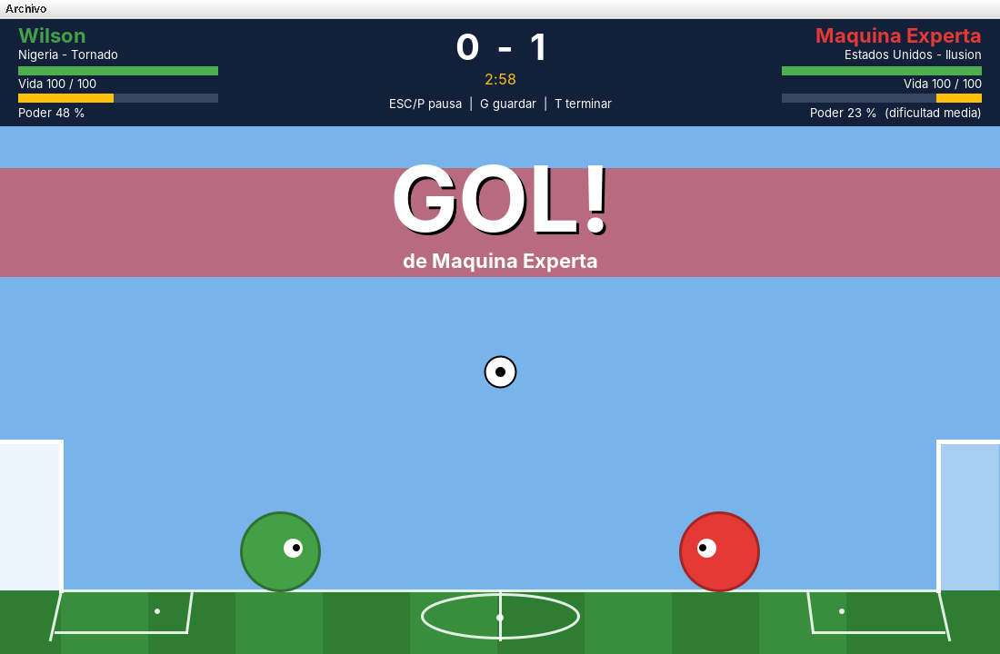{width=70%}

## 2. Dificultad de la máquina

**Pasos:** jugar contra la misma máquina en dificultad Baja, Media y Alta.

**Resultado esperado:** en Baja la máquina reacciona lento, se equivoca al ubicarse y a veces se queda quieta. En Alta reacciona rápido, casi no se equivoca y patea más. En el marcador se ve la dificultad elegida.

**Resultado:** pasa.

## 3. Error en la configuración

**Pasos:** dejar vacío el nombre del jugador 1 y presionar COMENZAR.

**Resultado esperado:** el partido no empieza y sale "Cada jugador debe tener un nombre".

**Resultado:** pasa.

{width=70%}

## 4. Resolución de la cancha

**Pasos:** elegir la cancha pequeña y luego la grande.

**Resultado esperado:** la cancha y la ventana cambian de tamaño.

**Resultado:** pasa.

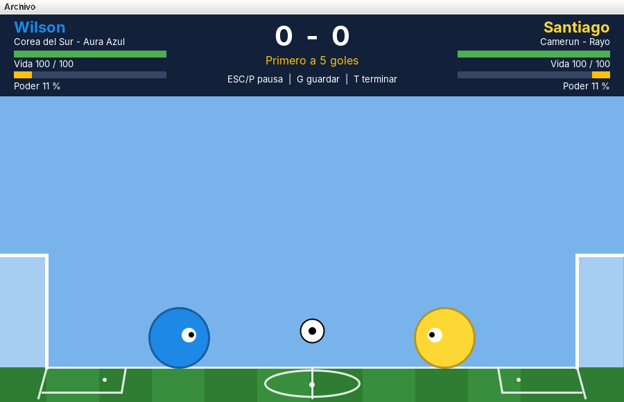{width=55%}

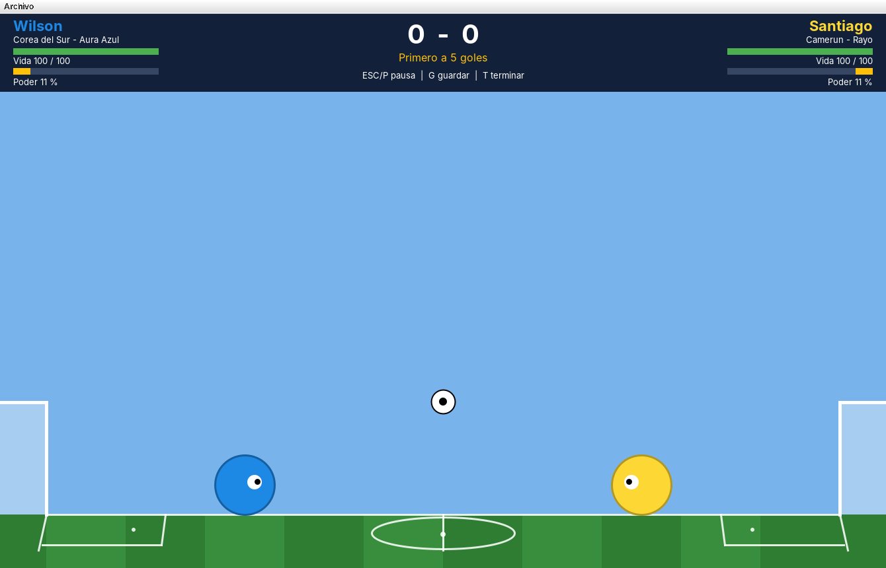{width=70%}

## 5. Personajes

**Pasos:** elegir un país diferente para cada jugador.

**Resultado esperado:** cada jugador sale con el color de su país y arriba se ve el nombre del país y de su poder.

**Resultado:** pasa (se ve en las imágenes de las pruebas 5 y 6).

## 6. Activar el poder

**Pasos:** esperar 10 segundos hasta que salga "PODER LISTO" y presionar E.

**Resultado esperado:** el jugador queda con aura, la barra vuelve a 0 y se empieza a llenar otra vez. Si se presiona E de nuevo no pasa nada.

**Resultado:** pasa.

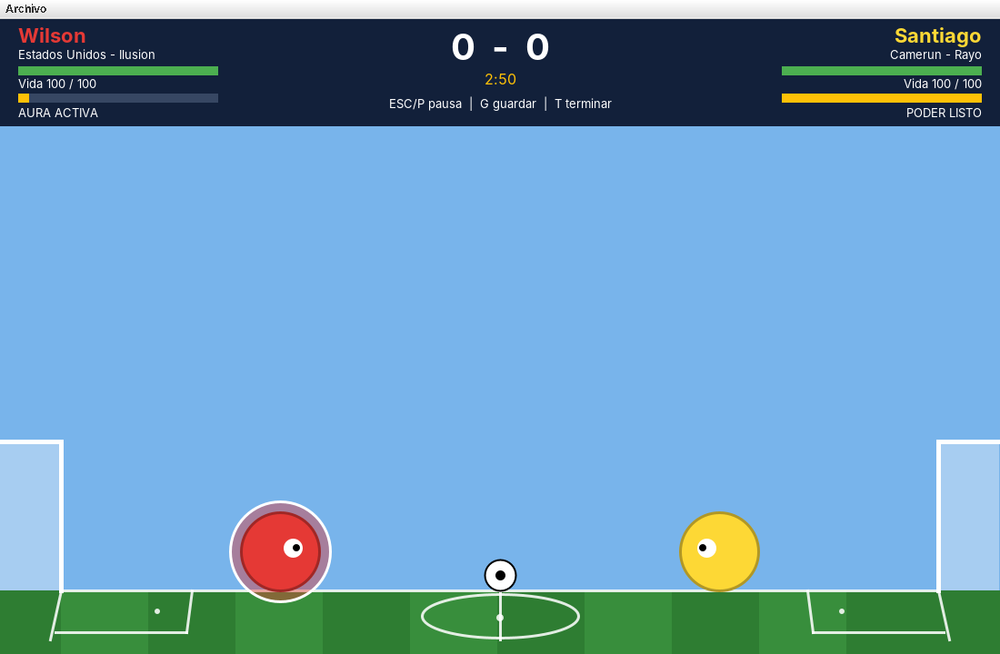{width=70%}

## 7. Tiros de poder

**Pasos:** con el aura activa, tocar el balón (Wilson con Estados Unidos y Santiago con Camerún).

**Resultado esperado:** con la Ilusión el balón se divide en 8 iguales y al rival le sale CONFUSION. Con el Rayo, al rival le baja la vida 60, le sale ELECTROCUTADO y no puede saltar.

**Resultado:** pasa.

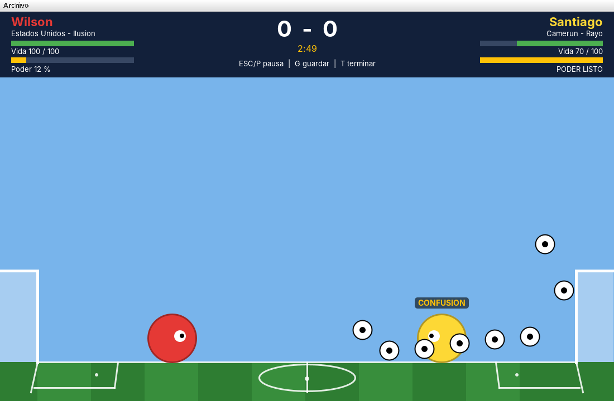{width=70%}

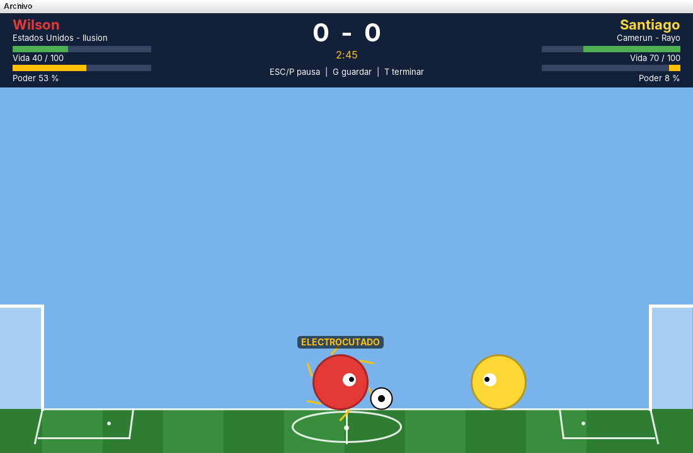{width=70%}

## 8. Vida y aturdimiento

**Pasos:** patear al rival hasta que su vida llegue a 0.

**Resultado esperado:** queda gris con "ATURDIDO zzz" y no se mueve durante 3 segundos. Después vuelve a tener toda la vida.

**Resultado:** pasa.

## 9. Pausa

**Pasos:** presionar ESC o P durante el partido.

**Resultado esperado:** el juego se detiene y sale PAUSA. Con la misma tecla sigue.

**Resultado:** pasa.

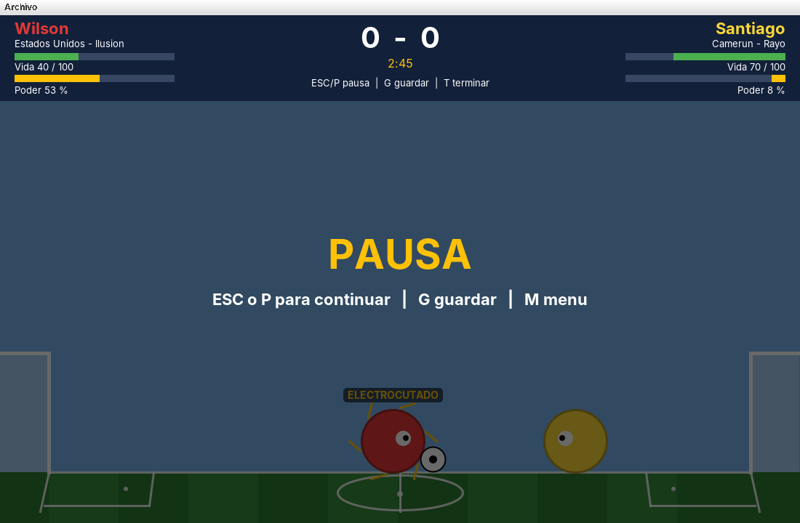{width=70%}

## 10. Terminar y puntos

**Pasos:** presionar T durante el partido.

**Resultado esperado:** sale el ganador (o EMPATE) y los puntos de cada uno: 100 al ganador y 25 al perdedor.

**Resultado:** pasa.

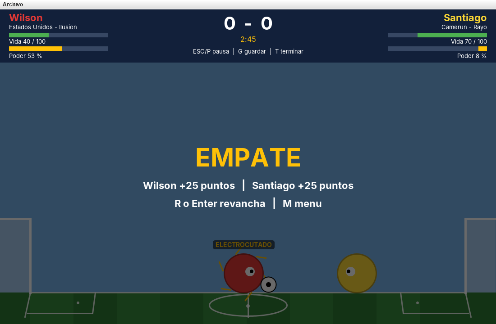{width=70%}

## 11. Mejorar estadísticas

**Pasos:** entrar a MEJORAS, elegir un jugador con 500 puntos y mejorar SURVIVAL.

**Resultado esperado:** le quedan 0 puntos, SURVIVAL queda en 2/10, la siguiente mejora cuesta 1000 y en el siguiente partido su vida es 110. Si no tiene puntos suficientes, sale un mensaje.

**Resultado:** pasa.

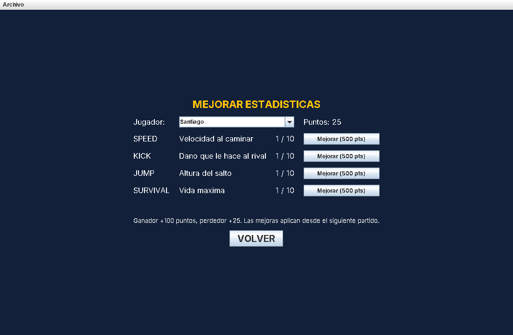{width=70%}

## 12. El progreso se mantiene

**Pasos:** cerrar el juego y volver a abrirlo.

**Resultado esperado:** los puntos y las estadísticas siguen iguales.

**Resultado:** pasa.

## 13. Animación del gol

**Pasos:** meter un gol.

**Resultado esperado:** aparece "GOL!" con el nombre del que anotó y la red parpadea. Durante 1 segundo nada se mueve y el reloj no corre; después sigue el saque desde el centro.

**Resultado:** pasa.

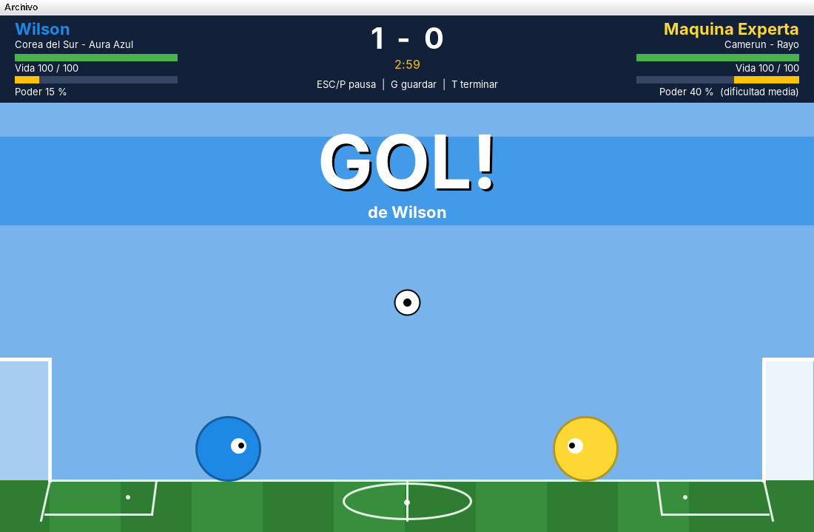{width=70%}

## 14. Guardar y abrir

**Pasos:** durante un partido presionar G y guardar. Después, en el menú, ABRIR PARTIDA y elegir ese archivo.

**Resultado esperado:** el partido vuelve con el mismo marcador, tiempo, vida y posiciones, y queda en pausa. Si se abre un archivo que no es una partida, sale "No se pudo abrir el archivo".

**Resultado:** pasa.
